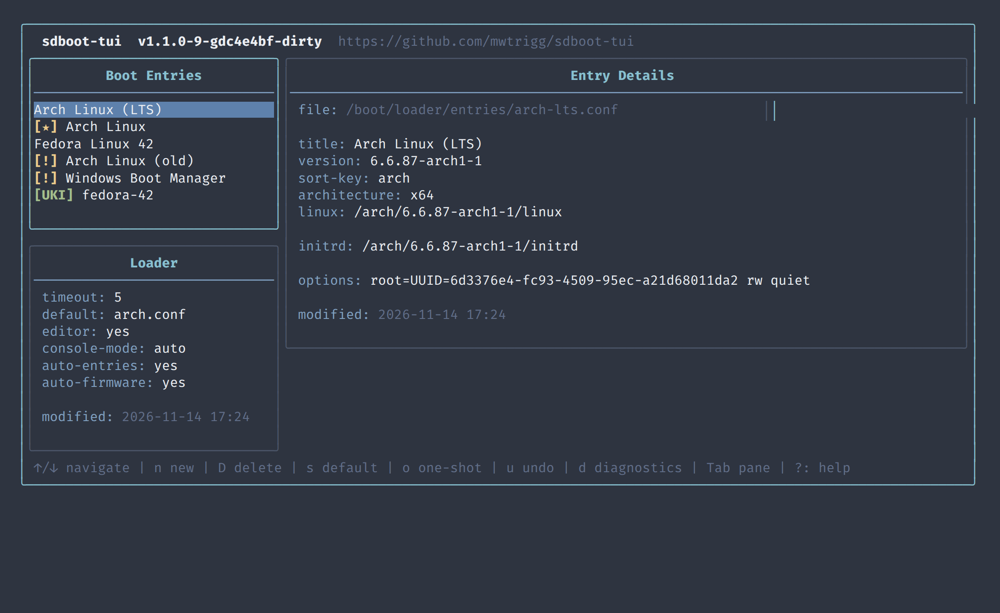

# sdboot-tui

A terminal UI for managing systemd-boot — browse, create, edit, and delete boot entries and loader configuration without touching config files directly.

> **Home repository:** [github.com/mwtrigg/sdboot-tui](https://github.com/mwtrigg/sdboot-tui)

---

## ⚠️ Security and Safety Warning

**This tool requires root (`sudo`) access and writes directly to your EFI System Partition.**

Before using, understand the following risks:

- **System may become unbootable** — incorrect paths for `linux` or `initrd` fields, or deleting a critical entry, can prevent your system from booting. Always verify paths against what actually exists on your ESP.
- **No undo** — file writes and deletions are immediate and permanent. There is no backup or undo functionality.
- **Kernel command-line exposure** — the `options` field is passed directly to the kernel at boot. Mistakes here (e.g. wrong `root=` UUID) will cause boot failure or unintended kernel behaviour.
- **ESP filesystem corruption** — the ESP is a FAT32 partition. Interrupted writes can corrupt it. Do not run this tool on an unstable system or over an unreliable connection.
- **EFI variable modification** — the one-shot boot feature writes EFI NVRAM variables directly. Interrupting an EFI variable write on some firmware implementations can leave the variable store in an inconsistent state.
- **Supply chain risk** — running any tool as root that was downloaded from the internet carries inherent risk. Review the source code before use, or build from source on a trusted machine.

---

## Screenshots


*Main view*


*Editing a boot entry*


*Save confirmation with diff view*

![ESP validation warning — [!] badge and missing-file errors](assets/04_EFI-Validation.png)
*ESP validation warnings*

---

## Features

- Browse all boot entries in `loader/entries/` and UKIs in `EFI/Linux/`
- Create new boot entries with guided field editing
- Delete existing entries with confirmation
- Set the default boot entry with a single keypress (`s`), reflected immediately in `loader.conf`
- View and edit all entry fields: title, version, linux, initrd, options, machine-id, architecture, sort-key, devicetree, devicetree-overlay
- View and edit all `loader.conf` settings: timeout, default, editor, console-mode, auto-entries, auto-firmware, auto-reboot, auto-poweroff, beep, reboot-on-error, log-level
- Add new `initrd` or `devicetree-overlay` lines to an existing entry with `Ctrl+N` in edit mode
- Per-field validation: path format, illegal characters, constrained values (architecture, console-mode, log-level, etc.)
- ESP file-existence validation — entries with missing kernel or initrd files are flagged with a `[!]` badge
- One-shot boot override: press `o` to set `LoaderEntryOneShot` for the selected entry (boots it once on next restart, then clears automatically). Shows a `[1x]` badge. EFI systems only.
- Inline editing with field-by-field navigation
- Tab completion for ESP filesystem paths (linux, initrd, devicetree fields)
- Context-sensitive help for each editable field
- Save confirmation with diff view
- File preview overlay — view the raw `.conf` file for any entry or `loader.conf`
- Last-modified timestamp shown for entries and loader config
- Keyboard navigation with arrow keys or `j`/`k`
- Tab/Shift+Tab to switch between panes
- Nord color theme

## Requirements

- Linux with systemd-boot installed
- ESP mounted at `/boot`, `/boot/efi`, or `/efi` (standard locations)
- Root or appropriate group membership to write to the ESP
- For one-shot boot: EFI system with `/sys/firmware/efi/efivars` accessible

## Installation

### Pre-built binary (eget)

[eget](https://github.com/zyedidia/eget) installs the latest release binary directly from GitHub:

```bash
sudo eget mwtrigg/sdboot-tui --to /usr/local/bin/
```

### go install

Requires Go 1.24+.

```bash
go install github.com/mwtrigg/sdboot-tui@latest
sudo mv "$(go env GOPATH)/bin/sdboot-tui" /usr/local/bin/
```

### AUR

Coming soon.

### From source

Requires Go 1.24+.

```bash
git clone https://github.com/mwtrigg/sdboot-tui
cd sdboot-tui
go build -o sdboot-tui .
sudo mv sdboot-tui /usr/local/bin/
```

## Usage

```bash
sudo sdboot-tui [-esp /path/to/esp]
```

Default ESP paths checked: `/boot`, `/boot/efi`, `/efi`

### Chroot / recovery environments

The `-esp` flag is useful when the ESP is not at a standard path — for example during Arch Linux installation or system recovery:

```bash
sudo sdboot-tui -esp /mnt/boot
```

One-shot boot (`o` key) writes to `/sys/firmware/efi/efivars` on the **running** system. From inside a chroot, this only works if `/sys` is bind-mounted into the chroot first:

```bash
mount --rbind /sys /mnt/sys
```

Without that, `efivars` will not be visible inside the chroot and the one-shot feature is silently disabled. Note: `arch-chroot` does this automatically.

### Keyboard shortcuts

| Key | Action |
|-----|--------|
| `↑`/`↓` or `j`/`k` | Navigate entry list |
| `Tab`/`Shift+Tab` | Switch panes |
| `n` | New boot entry |
| `D` | Delete selected entry |
| `s` | Set selected entry as default |
| `o` | Toggle one-shot boot (EFI only) |
| `e` | Enter edit mode |
| `↑`/`↓` | Navigate fields (in edit mode) |
| `Tab` | Next field / path completion (in edit mode) |
| `Ctrl+N` | Add new initrd/overlay line (in edit mode) |
| `Enter` | Save changes (in edit mode) |
| `Escape` | Cancel editing / discard new entry |
| `p` | Preview raw file (entries or loader.conf) |
| `?` | Toggle help overlay |
| `q`/`Ctrl+C` | Quit |

## Project structure

```
sdboot-tui/
├── main.go
├── internal/
│   ├── boot/               # ESP discovery, entry and loader.conf parsing, validation, EFI variables
│   └── ui/                 # Bubble Tea TUI
│       ├── model.go        # Model, Update, key handling
│       ├── view.go         # Layout, overlays, header, help bar
│       ├── edit.go         # Inline editing, tab completion, field definitions, validators
│       ├── pane_entries.go # Boot entries list pane
│       ├── pane_detail.go  # Entry details / edit pane
│       ├── pane_loader.go  # loader.conf view / edit pane
│       ├── styles.go       # Lip Gloss styles (Nord palette)
│       └── helpers.go      # Utility functions
└── testdata/               # Sample ESP layout for tests
```

## Built with

- [Bubble Tea](https://github.com/charmbracelet/bubbletea) — TUI framework
- [Bubbles](https://github.com/charmbracelet/bubbles) — reusable TUI components (textinput, spinner)
- [Lip Gloss](https://github.com/charmbracelet/lipgloss) — terminal styling

## Contributing

Issues and PRs welcome on [GitHub](https://github.com/mwtrigg/sdboot-tui).
The canonical repository is on [GitHub](https://github.com/mwtrigg/sdboot-tui).

## License

MIT
