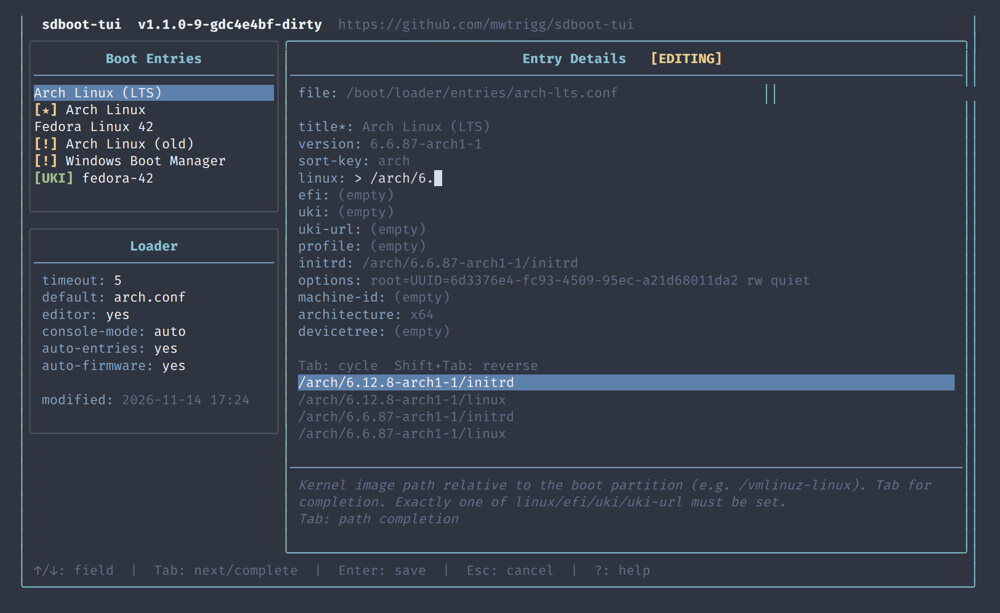
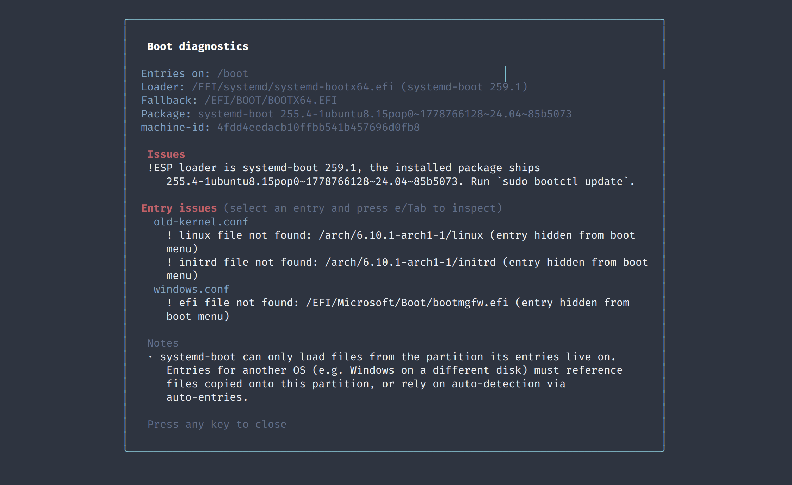

# sdboot-tui

A terminal UI for managing systemd-boot — browse, create, edit, and delete boot entries and loader configuration without touching config files directly.

---

## ⚠️ Security and Safety Warning

**This tool requires root (`sudo`) access and writes directly to your EFI System Partition.**

Before using, understand the following risks:

- **System may become unbootable** — incorrect paths for `linux`, `initrd`, or `efi` fields, or deleting a critical entry, can prevent your system from booting. The tool validates that referenced files exist and flags entries systemd-boot would hide — but always double-check paths against what actually exists on your ESP.
- **Every change is snapshotted, but backups are not a substitute for care** — before writing or deleting anything, sdboot-tui copies the affected file to `<boot-dir>/loader/sdboot-tui-backups/<timestamp>/`. Press `u` (or run `sdboot-tui --restore`) to roll back. Writes are atomic (temp file + `fsync` + rename, including directory sync for FAT32 durability), so an interrupted write can never leave a half-written file.
- **Kernel command-line exposure** — the `options` field is passed directly to the kernel at boot. Mistakes here (e.g. wrong `root=` UUID) will cause boot failure or unintended kernel behaviour. sdboot-tui warns when a kernel entry has no `root=` parameter at all.
- **ESP filesystem corruption** — the ESP is a FAT32 partition. Interrupted *mount-level* operations can corrupt it. Do not run this tool on an unstable system or over an unreliable connection.
- **EFI variable modification** — the one-shot boot feature writes EFI NVRAM variables directly. Interrupting an EFI variable write on some firmware implementations can leave the variable store in an inconsistent state.
- **Supply chain risk** — running any tool as root that was downloaded from the internet carries inherent risk. Review the source code before use, or build from source on a trusted machine.

---

## Screenshots


*Main view — entry badges: `[★]` default, `[!]` hidden entry, `[UKI]` unified kernel image*


*Editing a boot entry — path completion for kernel/initrd/EFI paths*


*Save confirmation with diff view*

![Validation warning — [!] badge and missing-file errors](assets/04_EFI-Validation.png)
*An entry whose kernel is gone — systemd-boot would hide it from the menu*


*Diagnostics (`d`) — loader binaries, version drift, broken entries*

<sub>All screenshots are generated from a synthetic sample ESP with `make screenshots`.</sub>

---

## Features

**Entries (Boot Loader Specification Type #1 & #2)**

- Browse all boot entries in `loader/entries/` and UKIs in `EFI/Linux/` (`.efi` and `.uki`)
- Create new boot entries with guided field editing, including **`efi` chainload entries for Windows/macOS dual boot**
- Delete existing entries with confirmation
- View and edit every BLS key: `title`, `version`, `linux`, `initrd`, `efi`, `uki`, `uki-url`, `profile`, `options`, `machine-id`, `architecture`, `sort-key`, `devicetree`, `devicetree-overlay`, `extra` (credentials, sysext/confext, UKI addons)
- Comments and vendor/unknown lines inside entry files are preserved verbatim on save
- Add new `initrd`, `extra`, or `devicetree-overlay` lines to an existing entry with `Ctrl+N` in edit mode
- Tab completion for boot-partition file paths (`linux`, `initrd`, `efi`, `uki`, `devicetree`, `extra`), case-insensitive, from the cached ESP layout
- Per-field validation: path format (the spec's optional leading `/` is accepted), illegal characters, constrained values (architecture, profile, etc.)
- Exactly one of `linux` / `efi` / `uki` / `uki-url` is enforced before saving — the mistake that makes systemd-boot silently drop an entry

**Loader configuration (`loader.conf`)**

- Set the default boot entry with a single keypress (`s`), written as the full entry ID (`.conf` suffix included, as loader.conf(5) requires)
- View and edit all `loader.conf` settings: `timeout`, `default`, `preferred`, `editor`, `console-mode`, `auto-entries`, `auto-firmware`, `auto-reboot`, `auto-poweroff`, `beep`, `reboot-for-bitlocker`, `reboot-on-error`, `secure-boot-enroll`, `secure-boot-enroll-action`, `secure-boot-enroll-timeout-sec`, `log-level`
- Unknown or distro-added options (e.g. `keyfile`) are displayed read-only and **survive saves** — a corrupted or exotic loader.conf can no longer break the panel, it warns line by line instead

**Validation & diagnostics**

- ESP file-existence validation — entries with missing kernel, initrd, EFI binary, or extra files are flagged with a `[!]` badge: **systemd-boot hides these entries from the boot menu**
- Detects other reasons an entry never appears: conflicting image keys, `architecture` mismatch with this machine, malformed lines
- Warns when a kernel entry lacks `root=` (boot then depends on systemd's gpt-auto-discovery — a common post-update bricking cause on Arch-family distros)
- Notes entries whose `machine-id` belongs to a different OS installation
- Checks that loader.conf `default=` actually matches an existing entry, with the classic suffix footgun explained in-place
- `d` opens a diagnostics overlay: XBOOTLDR vs ESP layout, presence and versions of `EFI/systemd/systemd-boot*.efi` and the `EFI/BOOT/BOOT*.EFI` fallback vs the packaged binary (`bootctl update` drift, Windows-update-overwritten fallback), active EFI-variable state
- One-shot boot override: press `o` to set `LoaderEntryOneShot` for the selected entry (boots it once on next restart, then clears automatically; works for `.conf` entries and UKIs). Shows a `[1x]` badge. EFI systems only
- `[★]` default badge matches `default=` globs the same way systemd-boot does (case-insensitive, full ID); `default @saved` highlights the last-booted entry via `LoaderEntryLastBooted` (`[●]` badge)
- **Undo** — every write and delete is snapshotted to `<boot-dir>/loader/sdboot-tui-backups/<timestamp>/` first; press `u` to restore the last snapshot (the undo itself is snapshotted, so it is reversible)
- Save confirmation with diff view
- File preview overlay — raw `.conf` for any entry or `loader.conf`; UKIs show path/size metadata
- Last-modified timestamp shown for entries and loader config
- Context-sensitive help for each editable field
- Keyboard navigation with arrow keys or `j`/`k`; `Tab`/`Shift+Tab`/`←`/`→` to switch panes
- Nord color theme

**Non-interactive mode**

- `sdboot-tui --check` prints the same diagnostics as the `d` overlay as plain text and exits non-zero when problems are found — handy for installer scripts, CI, or a machine you cannot boot into
- `sdboot-tui --restore` restores the most recent snapshot; `sdboot-tui --list-backups` lists what is available

## Requirements

- Linux with systemd-boot installed
- The boot loader directory (`loader/entries/…`) reachable at `/boot`, `/boot/efi`, or `/efi` — this covers both plain-ESP layouts and XBOOTLDR setups (Fedora-style separate `/boot`). The tool edits the first candidate containing a `loader/` directory, which is exactly where systemd-boot reads its entries
- Root or appropriate group membership to write to the ESP
- For one-shot boot and `[●]` last-booted badge: EFI system with `/sys/firmware/efi/efivars` accessible

## Installation

### Pre-built binary (eget)

[eget](https://github.com/zyedidia/eget) installs the latest release binary directly from GitHub:

```bash
sudo eget mwtrigg/sdboot-tui --to /usr/local/bin/
```

### go install

Requires Go 1.24+.

```bash
go install github.com/mwtrigg/sdboot-tui@latest
sudo mv "$(go env GOPATH)/bin/sdboot-tui" /usr/local/bin/
```

### From source

Requires Go 1.24+.

```bash
git clone https://github.com/mwtrigg/sdboot-tui
cd sdboot-tui
make build
sudo make install        # PREFIX=/usr/local by default
```

## Usage

```bash
sudo sdboot-tui [-esp /path/to/esp]
```

Default boot-directory paths checked: `/boot`, `/boot/efi`, `/efi`

### Non-interactive use

```bash
sdboot-tui --check                  # diagnostics report; exit 1 if problems were found
sdboot-tui --restore                # roll back the most recent change
sdboot-tui --list-backups           # list available snapshots
sdboot-tui --version
```

`--check` never writes anything and does not need root:

```console
$ sdboot-tui --check -esp /boot
sdboot-tui diagnostics
  boot directory : /boot
  loader        : /EFI/systemd/systemd-bootx64.efi (systemd-boot 259.1)
  fallback      : /EFI/BOOT/BOOTX64.EFI
  package       : systemd-boot 259.1
...
entries
  old-kernel.conf
    ! linux file not found: /arch/6.10.1-arch1-1/linux (entry hidden from boot menu)

3 problem(s) found
```

### Chroot / recovery environments

The `-esp` flag is useful when the ESP is not at a standard path — for example during Arch Linux installation or system recovery:

```bash
sudo sdboot-tui -esp /mnt/boot
```

One-shot boot (`o` key) writes to `/sys/firmware/efi/efivars` on the **running** system. From inside a chroot, this only works if `/sys` is bind-mounted into the chroot first:

```bash
mount --rbind /sys /mnt/sys
```

Without that, `efivars` will not be visible inside the chroot and the one-shot feature is silently disabled. Note: `arch-chroot` does this automatically.

### Keyboard shortcuts

| Key | Action |
|-----|--------|
| `↑`/`↓` or `j`/`k` | Navigate entry list |
| `Tab`/`Shift+Tab` or `←`/`→` | Switch panes |
| `n` | New boot entry |
| `D` | Delete selected entry |
| `s` | Set selected entry as default |
| `o` | Toggle one-shot boot (EFI only) |
| `u` | Undo the last change (restore the last snapshot) |
| `e` | Enter edit mode |
| `↑`/`↓` | Navigate fields (in edit mode) |
| `Tab` | Next field / path completion (in edit mode) |
| `Ctrl+N` | Add another initrd/extra/overlay line (in edit mode) |
| `Enter` | Save changes (in edit mode) |
| `Escape` | Cancel editing / discard new entry |
| `p` | Preview raw file (entries or loader.conf; UKIs show metadata) |
| `d` | Boot diagnostics overlay |
| `?` | Toggle help overlay |
| `q`/`Ctrl+C` | Quit |

## Troubleshooting

Common systemd-boot problems the diagnostics (`d`) and validation are built to catch:

**"My boot entry doesn't appear in the menu"**
systemd-boot *silently drops* entries it dislikes. A `[!]` badge marks each one:

- kernel/initrd/`efi` file missing on the boot partition — happens after kernel removal, path typos, or referencing files on a *different disk's* ESP (not supported: entries can only load files from the partition they live on; copy the other OS's EFI folder to your ESP, or rely on `auto-entries`)
- more than one of `linux`/`efi`/`uki`/`uki-url` set, or none
- `architecture` doesn't match this machine (case-insensitive)
- on XBOOTLDR setups some firmware skips non-ESP partitions when "fast boot" is enabled — disable it in firmware setup (the diagnostics overlay tells you when this layout is in use)
- also worth checking: `auto-entries no` hides Windows/macOS/EFI-shell auto-detection entirely

**"System boots into Windows after a Windows update"**
Windows updates overwrite the `\EFI\BOOT\BOOTX64.EFI` fallback (and sometimes the boot order). The diagnostics overlay flags a non-systemd-boot fallback binary. Recovery: boot via the firmware menu, then `sudo bootctl install` to restore the fallback, and use the one-shot feature (`o`) to reboot into firmware setup if needed.

**"System stopped booting after a kernel update" (missing `root=`)**
If a regenerated boot entry lost its `root=` parameter, systemd falls back to discovering the root by GPT partition type (Discoverable Partitions Spec); if your disk layout predates that, the boot hangs in the initramfs. sdboot-tui warns on entries without `root=`. Fix from a live USB (with `sdboot-tui -esp /mnt/boot` or manually): put `root=UUID=…` back in `options`, and correct whatever generator drops it (e.g. `/etc/kernel/cmdline` on dracut systems, then `reinstall-kernels`/kernel-install).

**"The default entry isn't being selected"**
`default=` is a case-insensitive glob matched against the **full entry ID, including the `.conf` suffix** — `default arch` matches nothing, `default arch.conf` matches. The loader pane flags patterns that select no entry. Use `default @saved` to remember the last manually selected entry (the `[●]` badge shows what will boot by default now).

**"Is one-shot really set?"**
Press `o`, then `d`: the overlay lists the current `LoaderEntryOneShot` value. sdboot-tui writes the full entry ID (`arch.conf`), which is what current systemd-boot matches against. Very old loaders expected the token without the suffix; if one-shot never fires on a pre-2023 systemd, that's why.

**General verification**
The boot loader's own view is authoritative: run `bootctl status` and `bootctl list` after editing, and preview the exact file (`p`) before saving. `sudo bootctl update` keeps the installed EFI binary in sync with the systemd package — the diagnostics overlay flags when it's stale.

## Known limitations

- Backups cover changes made through this tool, not changes made by your package manager or `kernel-install` — and they live on the boot partition (`loader/sdboot-tui-backups/`), so copy them elsewhere if the ESP itself is suspect
- UKI files (`EFI/Linux/*.efi`) are listed, previewed as metadata, settable as default and one-shot, but not created or edited here — they are built by `kernel-install`/`ukify`
- The entry list is shown in file-name order, not the boot menu's BLS sort order (sort-key/version); `bootctl list` shows the loader's own view
- Boot loader installation (`bootctl install`/`update`) and firmware boot order management stay in `bootctl`'s hands — sdboot-tui tells you when they're needed

## Project structure

```
sdboot-tui/
├── main.go
├── internal/
│   ├── boot/               # ESP discovery, entry and loader.conf parsing,
│   │                       # validation, diagnostics, EFI variables
│   │   ├── entry.go        # BLS Type #1 entries + round-trip writer
│   │   ├── loader.go       # loader.conf (lenient, round-trip preserving)
│   │   ├── validate.go     # "will systemd-boot show this entry?" checks
│   │   ├── diagnose.go     # ESP/loader layout + version inspection
│   │   ├── report.go       # shared report for the overlay and --check
│   │   ├── backup.go       # snapshots + restore
│   │   ├── efivar.go       # LoaderEntryOneShot / LastBooted
│   │   └── esp.go          # boot directory discovery
│   └── ui/                 # Bubble Tea TUI
│       ├── model.go        # Model, Update, key handling
│       ├── view.go         # Layout, overlays, header, help bar
│       ├── edit.go         # Inline editing, tab completion, field definitions, validators
│       ├── pane_entries.go # Boot entries list pane
│       ├── pane_detail.go  # Entry details / edit pane
│       ├── pane_loader.go  # loader.conf view / edit pane
│       ├── styles.go       # Lip Gloss styles (Nord palette)
│       └── helpers.go      # Utility functions
├── tools/screenshot.py     # regenerates the README screenshots (pty + pyte + Chrome)
└── testdata/               # Sample ESP layout for tests
```

## Specifications this tool implements

- [UAPI.1 Boot Loader Specification](https://uapi-group.org/specifications/specs/boot_loader_specification/) — entry files, keys, ID semantics
- [`loader.conf(5)`](https://www.freedesktop.org/software/systemd/man/latest/loader.conf.html) — loader options
- [systemd Boot Loader Interface](https://systemd.io/BOOT_LOADER_INTERFACE/) — EFI variables (`LoaderEntryOneShot`, `LoaderEntryLastBooted`, …)

## Contributing

Issues and PRs welcome on [GitHub](https://github.com/mwtrigg/sdboot-tui). The canonical repository is on [GitHub](https://github.com/mwtrigg/sdboot-tui). See [CONTRIBUTING.md](CONTRIBUTING.md) for the dev loop.

## License

MIT
