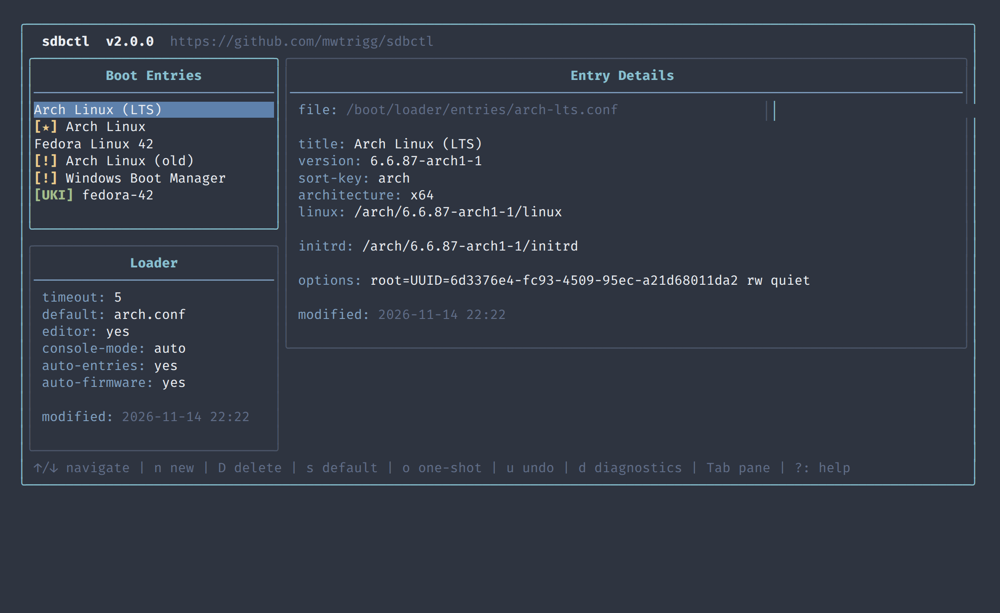
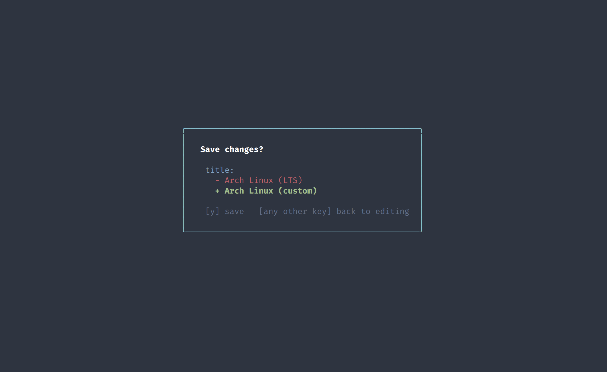

# sdbctl

Control systemd-boot from the command line — inspect what will boot, flip to another distro for the next restart, and find out *why* an entry is not showing up.

`sdbctl` is CLI-first: every operation is a verb with machine-readable output, so it works the same in a shell, in a script, and from an agent. A full-screen editor is still there (`sdbctl edit`) for the things a terminal UI is better at.

> Formerly `sdboot-tui`. The repository, module and binary were renamed in v2.0; old installs keep working but will not receive updates.

---

## ⚠️ Safety

**Changing boot settings requires root (`sudo`) and writes to your EFI System Partition.**

- **System may become unbootable** — a wrong `linux`/`efi` path or a deleted entry can stop the machine from booting. sdbctl validates that referenced files exist and flags the entries systemd-boot will hide, but always check paths against what is really on your ESP.
- **Every change is snapshotted** — before anything is written or deleted, the affected file is copied to `<boot-dir>/loader/sdbctl-backups/<timestamp>/`. `sdbctl undo` rolls back; `sdbctl snapshots` lists them.
- **Writes are atomic** (temp file, `fsync`, rename, directory sync) so an interrupted write cannot leave a half-written file — but an overwrite is still an overwrite.
- **Kernel command lines are passed straight to the kernel** — a wrong `root=` UUID means an unbootable machine. Entries without `root=` are flagged.
- **EFI variables** — the one-shot feature writes NVRAM directly. On some firmware an interrupted variable write can leave the variable store inconsistent.
- **Supply chain** — review the source, or build it yourself on a machine you trust.

---

## Install

```bash
# pre-built binary
sudo eget mwtrigg/sdbctl --to /usr/local/bin/

# from source (Go 1.24+)
go install github.com/mwtrigg/sdbctl@latest
# or
git clone https://github.com/mwtrigg/sdbctl && cd sdbctl && make install
```

Shell completions:

```bash
sdbctl completion bash > /etc/bash_completion.d/sdbctl
sdbctl completion zsh  > "${fpath[1]}/_sdbctl"
sdbctl completion fish > ~/.config/fish/completions/sdbctl.fish
```

---

## Quick start

```console
$ sdbctl
boot directory  /boot
loader          /EFI/systemd/systemd-bootx64.efi  (systemd-boot 259.1)
package         systemd-boot 259.1
default         arch.conf
timeout         5

  arch-lts.conf      Arch Linux (LTS)         6.6.87-arch1-1
* arch.conf          Arch Linux               6.12.8-arch1-1
  fedora.conf        Fedora Linux 42          6.12.8-200.fc42.x86_64
! old-kernel.conf    Arch Linux (old)         6.10.1-arch1-1
    linux file not found: /arch/6.10.1-arch1-1/linux (entry hidden from boot menu)
! windows.conf       Windows Boot Manager     11
    efi file not found: /EFI/Microsoft/Boot/bootmgfw.efi (entry hidden from boot menu)
```

Flip to the other distro for the next restart, and go there now:

```console
$ sudo sdbctl boot fedora.conf --reboot
one-shot set
  entry      fedora.conf  Fedora Linux 42
  next boot  Fedora Linux 42
  rebooting now
```

Make it permanent, remember the last choice, or set the timeout:

```console
$ sudo sdbctl default fedora.conf
$ sudo sdbctl default @saved
$ sudo sdbctl timeout 3
```

---

## Commands

| Verb | What it does |
|------|--------------|
| *(none)*, `status` | Boot status: what will boot, what is set for next time, what is broken |
| `list` | One line per entry; `--ids` prints bare IDs, `--json` prints JSON |
| `boot <entry>` | Boot an entry once on the next restart; `--reboot` restarts now |
| `default <entry>` | Set the persistent default entry (or `@saved`) |
| `timeout <value>` | Menu timeout: seconds, `menu-force`, `menu-hidden`, `menu-disabled` |
| `set <key> <value>` | Set any `loader.conf` option; an empty value clears it |
| `rm <entry>` | Delete an entry (snapshotted first, so it is undoable) |
| `undo` | Restore the most recent snapshot |
| `snapshots` | List snapshots |
| `check` | Full diagnostics; **exit 1 when problems were found** |
| `edit`, `-e` | Launch the full-screen editor |
| `mcp` | Serve the same operations over stdio as an MCP server |
| `completion <shell>` | Print a completion script (bash, zsh, fish) |
| `version`, `help` | Version, usage |

Global flags: `--esp PATH`, `--json`, `--dry-run`, `--force`, `--yes`, `--quiet`.

Entries can be named by ID (`fedora`), full ID (`fedora.conf`), or glob (`fedora-*`); ambiguous globs are refused with the candidates listed.

### Exit codes

| Code | Meaning |
|------|---------|
| 0 | Success |
| 1 | An operation failed, or `check` found problems |
| 2 | Bad command line |

---

## Machine-readable output

Every verb accepts `--json`. The schema is stable and is the same one the MCP server returns, so scripts and agents see identical data:

```console
$ sdbctl list --json | jq -r '.entries[] | select(.hidden) | .fullId'
old-kernel.conf
windows.conf

$ sdbctl list --json | jq -r '.entries[] | select(.isDefault) | .title'
Arch Linux
```

Fields include `id`, `fullId`, `title`, `imageKeys`, `isDefault`, `isOneShot`, `isLastBooted`, `hidden` and `issues`. `hidden` is the important one: it means *systemd-boot will not show this entry in the boot menu*.

---

## MCP server

`sdbctl mcp` speaks the Model Context Protocol over stdio, so an agent can inspect and change boot settings with the same semantics the CLI has:

```bash
sudo sdbctl mcp                 # read-only
sudo sdbctl mcp --allow-write   # read/write
```

Point an MCP client at it:

```json
{
  "mcpServers": {
    "sdbctl": {
      "command": "sudo",
      "args": ["sdbctl", "mcp", "--allow-write"]
    }
  }
}
```

Tools: `sdbctl_status`, `sdbctl_list_entries`, `sdbctl_check`, `sdbctl_snapshots`, and — only with `--allow-write` — `sdbctl_boot`, `sdbctl_set_default`, `sdbctl_set_timeout`, `sdbctl_set_key`, `sdbctl_remove_entry`, `sdbctl_undo`.

Safety posture, deliberately conservative for a tool that edits the thing that boots the machine:

- **read-only by default** — the write tools are not even advertised without `--allow-write`
- rebooting requires both `--allow-write` and an explicit `reboot` argument
- every mutating result reports the snapshot id and the undo command, so a client can roll back what it just did
- results come back as both human-readable text and `structuredContent` JSON

---

## The editor

`sdbctl edit` (or `sdbctl -e`) opens the full-screen editor for the things a TUI does better: browsing entries with their warnings, editing every field with context help and path completion, previewing raw files, and a diff before anything is written.


*Main view — badges: `[★]` default, `[!]` hidden entry, `[UKI]` unified kernel image*


*Editing a boot entry — path completion for kernel/initrd/EFI paths*


*Save confirmation with diff view*

![Validation warning — [!] badge and missing-file errors](assets/04-entry-validation.png)
*An entry whose kernel is gone — systemd-boot would hide it from the menu*


*Diagnostics (`d`) — loader binaries, version drift, broken entries*

<sub>The screenshots are generated from a synthetic sample ESP with `make screenshots`.</sub>

---

## What it checks

`systemd-boot` **silently drops** entries it does not like. sdbctl reproduces those rules, using the version of the boot loader binary actually installed on the ESP (read from its `.sdmagic` section), because the rules changed over time:

| Condition | Effect |
|-----------|--------|
| kernel/initrd/EFI file missing | entry hidden |
| more than one of `linux`/`efi`/`uki`/`uki-url` | hidden on systemd ≥ 258; older versions boot the last one listed |
| `architecture` does not match this machine | entry hidden |
| `uki`/`uki-url` on systemd < 258 | key unknown, entry hidden |
| `extra`/`profile` on older systemd | key ignored (companion files not passed) |
| no `root=` in the command line | boot depends on systemd's gpt-auto-discovery — the classic post-update brick |

It also reports the loader state itself: whether the ESP copy is older than the packaged one (`bootctl update`), whether the `\EFI\BOOT` fallback was replaced (Windows updates do this), whether `default=` matches any entry at all, and whether a foreign `machine-id` means the entry belongs to another installation.

All of these predictions are **verified against the real boot loader**: `make boot-oracle` boots the packaged systemd-boot under qemu + OVMF against a synthetic ESP and diffs sdbctl's predictions against the menu it actually renders.

---

## Troubleshooting

**"My entry doesn't appear in the boot menu"** — run `sdbctl check`. Entries systemd-boot will hide are marked `!` in `sdbctl list` and explained in the check output: missing kernel/initrd/EFI files (including after a kernel upgrade or when pointing at another disk's ESP), conflicting image keys, an `architecture` for another machine, or `uki` on an old boot loader. On XBOOTLDR setups, some firmware skips non-ESP partitions when "fast boot" is enabled.

**"Windows disappeared after an update"** — Windows updates overwrite `\EFI\BOOT\BOOTX64.EFI`. The diagnostics flag a fallback that is no longer systemd-boot. Restore it with `sudo bootctl install`, then `sudo sdbctl boot windows.conf --reboot`.

**"The system stopped booting after a kernel update"** — usually the entry lost its `root=`, so systemd falls back to discovering the root by GPT partition type and the initramfs hangs. sdbctl flags entries without `root=`. Fix it from a live USB: add `root=UUID=…` to the entry's `options`, and fix whatever generator drops it (e.g. `/etc/kernel/cmdline` on dracut systems, then `reinstall-kernels`).

**"The default entry is not being selected"** — `default=` is a case-insensitive glob matched against the **full entry ID including the `.conf` suffix**: `default arch` matches nothing, `default arch.conf` matches. `sdbctl default <entry>` always writes the correct form.

**"Is my one-shot set?"** — `sdbctl status` shows the pending one-shot. sdbctl writes the full entry ID, which is what current systemd-boot matches against.

**General verification** — `bootctl status` and `bootctl list` remain authoritative for what the loader sees; `sdbctl` is authoritative for what sdbctl will write.

---

## Known limitations

- Snapshots cover changes made through this tool, and they live on the boot partition (`loader/sdbctl-backups/`) — copy them elsewhere if the ESP itself is suspect. Snapshots taken by the pre-rename releases are still listed and restorable.
- Unified kernel images (`EFI/Linux/*.efi`) can be listed, previewed, booted and made default, but not created or edited — that is `kernel-install`/`ukify` territory.
- The entry list is in file-name order, not the boot menu's BLS sort order; `bootctl list` shows the loader's own view.
- Installing and updating the boot loader itself stays with `bootctl install` / `bootctl update`; sdbctl tells you when they are needed.
- `sdbctl` does not create entries; use `sdbctl edit` for that.

---

## Project structure

```
sdbctl/
├── main.go
├── internal/
│   ├── boot/               # ESP discovery, entry and loader.conf parsing,
│   │                       # validation, diagnostics, snapshots, EFI variables
│   │   ├── entry.go        # BLS Type #1 entries + round-trip writer
│   │   ├── loader.go       # loader.conf (lenient, round-trip preserving)
│   │   ├── loader_set.go   # assigning loader.conf options by name
│   │   ├── validate.go     # "will systemd-boot show this entry?" checks
│   │   ├── diagnose.go     # ESP/loader layout + version inspection
│   │   ├── report.go       # shared report for status/check/MCP
│   │   ├── backup.go       # snapshots + restore
│   │   ├── efivar.go       # LoaderEntryOneShot / LastBooted
│   │   └── esp.go          # boot directory discovery
│   ├── cli/                # the command surface
│   │   ├── api.go          # every operation, typed results, no printing
│   │   ├── cli.go          # argument parsing, rendering, exit codes
│   │   ├── mcp.go          # MCP server over stdio
│   │   └── completion.go   # bash/zsh/fish completion scripts
│   └── ui/                 # Bubble Tea editor
│       ├── model.go        # Model, Update, key handling
│       ├── view.go         # Layout, overlays, header, help bar
│       ├── edit.go         # Inline editing, tab completion, field definitions, validators
│       ├── pane_entries.go # Boot entries list pane
│       ├── pane_detail.go  # Entry details / edit pane
│       ├── pane_loader.go  # loader.conf view / edit pane
│       ├── styles.go       # Lip Gloss styles (Nord palette)
│       └── helpers.go      # Utility functions
├── tools/
│   ├── bootoracle.py       # boots real systemd-boot and checks our predictions
│   └── screenshot.py       # regenerates the README screenshots
└── docs/sdbctl.1           # man page
```

---

## Specifications implemented

- [UAPI.1 Boot Loader Specification](https://uapi-group.org/specifications/specs/boot_loader_specification/) — entry files, keys, ID semantics
- [`loader.conf(5)`](https://www.freedesktop.org/software/systemd/man/latest/loader.conf.html) — loader options
- [systemd Boot Loader Interface](https://systemd.io/BOOT_LOADER_INTERFACE/) — EFI variables (`LoaderEntryOneShot`, `LoaderEntryLastBooted`, …)

## Contributing

See [CONTRIBUTING.md](CONTRIBUTING.md). The test tiers are worth knowing about: unit tests and fuzz targets run everywhere, and `make boot-oracle` boots a real systemd-boot under qemu to check our predictions.

## License

MIT
